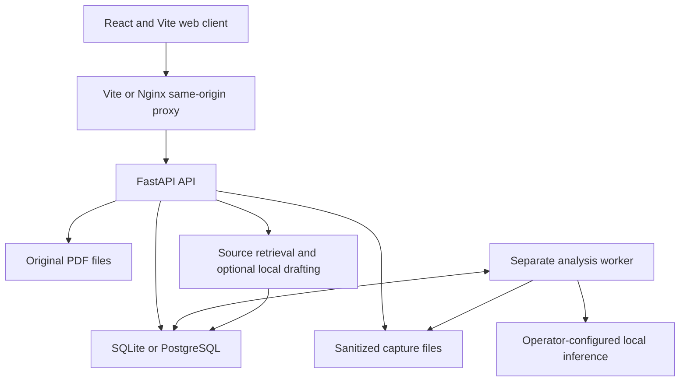

# Posify: Current System Documentation

Last reviewed: 2026-11-05

This is the canonical, single-file description of the implemented Posify
application. It covers the product, architecture, workflows, setup, operations,
verification, and known non-ML work. Model training, dataset preparation, and ML
experimentation are intentionally outside this document.

## 1. Product purpose

Posify is a local-first equipment evidence and inspection workbench. It helps a
factory team preserve image evidence, connect it to an installed physical asset,
follow a versioned procedure, and produce a traceable inspection record.

The central product rule is:

> Machine output is evidence. A person establishes physical asset identity.

The application can locate likely nameplate regions, read text through a configured
local inference runtime, extract proposed fields, and compare those fields with
factory and catalogue records. It does not silently convert those proposals into a
confirmed asset assignment.

## 2. Implemented capabilities

The repository currently implements:

- A responsive React operator workspace with demo and live API modes.
- Organizations, factories, named users, factory memberships, and global flags.
- Opaque bearer credentials with expiry, revocation, and digest-only storage.
- A factory registry for installed assets with revision-protected metadata edits.
- A global manufacturer/model catalogue with draft and publication states.
- Immutable catalogue document revisions, including bounded PDF imports.
- Versioned factory procedures tied to manufacturer and model.
- Sanitized, content-addressed image capture storage.
- A durable SQL-backed analysis queue with leases, retries, cancellation, and
  fenced result commits.
- Stored analysis evidence and explicit capture-to-asset confirmation.
- Procedure-based inspections with immutable observations and attached evidence.
- Inspection submission and independent supervisor review.
- Two-person corrections for catalogue links and unattached capture assignments.
- Sequenced audit records for important mutations.
- Factory-scoped JSON exports and integrity-checked database/file snapshots.
- Source-labelled knowledge retrieval with an optional local answer-drafting
  runtime that has no mutation tools.
- SQLite development operation and PostgreSQL deployment support.
- Docker Compose definitions for web, database, migrations, API, and worker.
- Generated OpenAPI contracts shared by the Python API and TypeScript client.

## 3. Deliberate boundaries

Posify does not claim that:

- A detector or OCR score proves equipment identity.
- Similar appearance proves manufacturer, model, or physical asset identity.
- An inspection submission or review proves equipment is safe to operate.
- A supplied source reference is manufacturer verification.
- Software tests establish recognition accuracy or production readiness.

The application does not currently provide QR decoding, 3D reconstruction,
work-order integration, or whole-machine visual identification. Those functions are
not required by the current evidence-to-inspection workflow.

## 4. Runtime architecture



The runtime has five main processes or stores:

| Component | Responsibility |
| --- | --- |
| Web client | Operator workflows, evidence review, and API presentation |
| API | Authentication, authorization, validation, workflow rules, and audit |
| Worker | Claims durable jobs and performs configured analysis outside DB transactions |
| SQL database | Registry, catalogue, procedures, jobs, inspections, reviews, and audit |
| File stores | Normalized captures and original catalogue PDFs |

The API and worker communicate through SQL, not through an internal HTTP queue.
The worker and API must share the database and capture store. Model files are
operator-provisioned and mounted read-only in the supplied container layout.

## 5. Technology stack

| Area | Technology |
| --- | --- |
| Backend | Python 3.12+, FastAPI, Pydantic |
| Persistence | SQLAlchemy Core-style connections, handwritten SQL, Alembic |
| Databases | SQLite for development, PostgreSQL 17 for deployment |
| Web | React 19, TypeScript 5.9, Vite 8 |
| Web tests | Vitest, Testing Library, jsdom |
| Backend tests | Pytest and FastAPI TestClient |
| Images | Pillow and protected filesystem storage |
| Deployment | Docker, Docker Compose, Nginx |
| Contract | Generated OpenAPI JSON and TypeScript declarations |

There is no root JavaScript workspace manager. The frontend is a standalone npm
package under `apps/web`. The Python package is installed from the root
`pyproject.toml` and discovered under `services/api`.

## 6. Repository map

| Path | Purpose |
| --- | --- |
| `apps/web/` | React client, browser tests, Nginx config, and frontend image assets |
| `services/api/posify/` | API, security, workflows, persistence, worker, and adapters |
| `services/api/posify/migrations/` | Alembic schema revisions |
| `services/api/tests/` | Backend workflow and integration tests |
| `packages/contracts/openapi.json` | Tracked generated API contract |
| `scripts/` | Migrations, provisioning, snapshots, contract export, and smoke tools |
| `docs/` | Focused operational and API references |
| `examples/` | Recorded development fixtures and source provenance |
| `compose.yaml` | Web, PostgreSQL, migration, API, and worker services |
| `.github/workflows/tests.yml` | Frontend, SQLite, and PostgreSQL CI checks |
| `var/` | Ignored local database, captures, documents, and runtime output |
| `models/` | Ignored operator-provisioned runtime artifacts |

Training and experimentation directories are intentionally excluded from this
application map and from the work described in this document.

## 7. Domain and ownership model

### Global records

- Catalogue models contain manufacturer, model, variant, category, provenance,
  status, and creation metadata.
- Catalogue documents are immutable title/revision records owned by one model.
- Models and documents start as drafts and require explicit curator publication.
- Global records never contain a factory asset's serial number or inspection history.

### Factory records

- An organization owns one or more factories.
- A factory owns installed assets, procedures, captures, inspections, and audit data.
- Asset tags and non-null serials are unique within a factory.
- An asset has a revision used for optimistic concurrency.
- Only location and category are directly editable through the current asset update
  API. Physical identity fields require a future reviewed workflow.

### Evidence records

- A capture references a normalized PNG by SHA-256 and stores dimensions, warnings,
  factory ownership, and creation time.
- A capture may have multiple immutable analyses.
- A capture has at most one confirmed physical asset assignment.
- A confirmed capture can be attached to inspections for that same asset.
- Once attached to an inspection, a capture assignment cannot be corrected.

### Inspection records

- An inspection pins one asset and one procedure version.
- Each procedure step accepts one immutable `pass`, `fail`, or `unknown` observation.
- Every procedure step must have an observation before submission.
- Submission makes observations and evidence attachments immutable.
- A different authorized person may record one independent review.
- An inspection containing `fail` or `unknown` cannot receive an `accepted` review.

## 8. Authentication and authorization

Two authentication modes exist:

- `development`: a shared `X-API-Key` bootstrap administrator and individual bearer
  tokens are accepted.
- `users`: only individual bearer tokens are accepted.

Requests must use exactly one credential scheme. Browser credentials remain only in
React memory and are lost on refresh or disconnect. They are not written to local
storage, IndexedDB, cookies, URLs, or compiled JavaScript.

Factory roles are cumulative:

| Role | Main capabilities |
| --- | --- |
| Viewer | Read factory records, images, jobs, audit, exports, and source results |
| Technician | Upload, analyze, confirm captures, and record inspections |
| Supervisor | Technician capabilities plus independent reviews and correction decisions |
| Manager | Supervisor capabilities plus assets, procedures, metadata edits, links, and correction requests |
| Curator | Create, inspect, and publish global catalogue knowledge |
| Administrator | Global factory, access, catalogue, and runtime administration |

A curator does not need factory membership to use the global catalogue. Factory
screens remain unavailable until the account has a factory membership. Backend
authorization is authoritative; frontend visibility is only a usability control.

## 9. Main operator workflows

### 9.1 Connect a workspace

1. An administrator provisions a user, factory membership, and bearer token.
2. The user opens the read-only demo client and chooses Connection settings.
3. The client verifies `/v1/me` and discovers `/v1/workspaces`.
4. If at least one factory is available, the first factory becomes active.
5. If no factory is available, the client opens the global catalogue and hides
   factory-only navigation.

### 9.2 Register and maintain an asset

1. A manager registers the installed physical asset.
2. A manager may update location or category using the current asset revision and a
   reason.
3. A stale revision returns `409` and does not overwrite a concurrent change.
4. A manager may connect the asset to a published catalogue model when manufacturer
   and model agree.
5. An asset with no catalogue link returns `200 null`; a missing asset returns `404`.
6. Replacing an existing link requires the two-person correction workflow.

### 9.3 Capture and confirm evidence

1. A technician uploads raw PNG or JPEG bytes, not multipart form data.
2. The API limits the upload, validates its encoding and dimensions, applies EXIF
   orientation, converts it to RGB, and writes a metadata-free PNG.
3. Content-identical normalized images within a factory replay the existing capture.
4. The technician queues analysis when a local analysis runtime is configured.
5. The worker stores evidence and candidates but never assigns the asset.
6. The technician checks the source image and explicitly confirms a factory asset.
7. Replaying the same assignment is safe; silent reassignment returns `409`.

### 9.4 Run an inspection

1. A technician selects an asset and an applicable procedure.
2. The technician explicitly attests that the physical asset was verified.
3. The inspection pins the selected procedure ID.
4. The technician records one result for every procedure step.
5. The evidence selector requests only captures confirmed for the inspection asset.
6. Confirmed captures may be attached while the inspection is open.
7. After every step is recorded, the technician submits the inspection.
8. A separate supervisor or manager may review the submitted record.

### 9.5 Manage catalogue knowledge

1. A curator creates a draft catalogue model with provenance.
2. The curator reviews and explicitly publishes the model.
3. The curator may import bounded PDF documents as immutable draft revisions.
4. Extracted page text is reviewed before publication.
5. Published documents become eligible source material only through a confirmed
   asset catalogue link.

### 9.6 Correct confirmed links

1. A named manager requests a correction and supplies a reason.
2. A different named supervisor or manager approves or rejects it.
3. Approval rechecks the current values, asset revision, ownership, and catalogue
   applicability.
4. The decision and resulting mutation are immutable and audited.

## 10. API groups

| Prefix or route | Purpose |
| --- | --- |
| `/health` | Public API process health |
| `/v1/me`, `/v1/workspaces` | Principal and authorized factory discovery |
| `/v1/access/*` | User, membership, token, and revocation administration |
| `/v1/organizations`, `/v1/factories` | Global ownership provisioning |
| `/v1/assets`, `/v1/sites/{site}/assets/*` | Installed asset registry and catalogue links |
| `/v1/catalog/*` | Global models, documents, imports, and publication |
| `/v1/sites/{site}/captures/*` | Uploads, metadata, images, analyses, and confirmation |
| `/v1/sites/{site}/jobs/*` | Durable analysis jobs and cancellation |
| `/v1/procedures` | Factory procedure versions |
| `/v1/inspections/*` | Inspection creation, observations, and submission |
| `/v1/sites/{site}/inspections/*` | Evidence and independent reviews |
| `/v1/sites/{site}/corrections` | Correction requests and decisions |
| `/v1/assistant/query` | Asset-scoped source retrieval and optional drafts |
| `/v1/sites/{site}/audit` | Sequenced factory audit events |
| `/v1/sites/{site}/pack` | Consistent factory JSON export |
| `/v1/runtime`, `/v1/operations` | Runtime configuration and operational counts |

Capture history supports `limit`, `offset`, and optional `asset_id`. When `asset_id`
is present, only captures confirmed for that asset are returned.

Interactive OpenAPI documentation is available at `/docs` while the API is running.

## 11. Persistence and correctness

The backend uses SQLAlchemy for connections, transactions, and parameter binding,
but domain repositories issue explicit SQL. SQLite positional placeholders are
translated to named parameters for PostgreSQL.

Important guarantees include:

- SQLite enables foreign keys and WAL mode.
- PostgreSQL startup validates the Alembic revision.
- Mutations and their audit records commit in the same database transaction.
- Explicit write transactions use SQLite locking or a PostgreSQL advisory lock.
- Asset metadata uses optimistic revisions.
- Client-supplied UUIDs make supported mutation retries idempotent.
- Worker claims use a lease and fencing token.
- Only the current unexpired worker claim can commit success and analysis together.
- Submitted inspections reject further observations and evidence.
- Strict Pydantic request models reject unknown fields.

Capture and PDF files live outside SQL. File creation and database insertion are not
one atomic transaction, so failed writes can leave unreferenced files. No automatic
garbage collector or retention policy exists yet.

## 12. Local development

### Requirements

- Python 3.12 or newer.
- Node.js 24 for the web client.
- A generated API token.
- Optional local analysis dependencies only when testing analysis.

The application does not automatically load `.env` for direct shell commands.
Export variables in the shell or use Docker Compose.

### Windows PowerShell

```powershell
py -3.12 -m venv .venv
& ".venv\Scripts\Activate.ps1"
python -m pip install -r requirements-dev.lock
python -m pip install --no-deps -e .
$env:POSIFY_API_TOKEN = & python -c "import secrets; print(secrets.token_urlsafe(32))"
python -m uvicorn posify.app:app --host 127.0.0.1 --port 8000
```

Start the worker in a second activated terminal with the same environment:

```powershell
python -m posify.worker
```

Start the web client in a third terminal:

```powershell
npm ci --prefix apps/web
npm run dev --prefix apps/web
```

### POSIX shell

```bash
python -m venv .venv
source .venv/bin/activate
pip install -r requirements-dev.lock
pip install --no-deps -e .
export POSIFY_API_TOKEN="$(python -c 'import secrets; print(secrets.token_urlsafe(32))')"
uvicorn posify.app:app --host 127.0.0.1 --port 8000
```

Run `python -m posify.worker` separately and run `npm ci && npm run dev` from
`apps/web`.

SQLite is created and migrated at `var/posify.db` by default. The Vite client proxies
`/v1` and `/health` to `http://127.0.0.1:8000` unless `POSIFY_API_URL` overrides the
development target.

## 13. PostgreSQL and containers

For direct PostgreSQL operation:

1. Set `POSIFY_DATABASE_URL` to a `postgresql+psycopg://` URL.
2. Run `python scripts/migrate.py` once before the API or worker starts.
3. Start the API and worker with the same database and file-store configuration.

For the supplied Compose stack:

1. Create `.env` from `.env.example`.
2. Replace the API token placeholder.
3. Set a generated URL-safe `POSIFY_DB_PASSWORD`.
4. Ensure the `models` directory exists even when analysis is disabled.
5. Run `docker compose up --build`.

Compose serves the web client at `http://127.0.0.1:8080` and the API at
`http://127.0.0.1:8000`. PostgreSQL is internal. Database, capture, and document
data use persistent volumes. TLS, managed secrets, monitoring, resource limits, and
retention remain deployment responsibilities.

## 14. Important configuration

| Variable | Purpose |
| --- | --- |
| `POSIFY_API_TOKEN` | Development bootstrap credential |
| `POSIFY_AUTH_MODE` | `development` or bearer-only `users` mode |
| `POSIFY_DB` | SQLite path when no database URL is supplied |
| `POSIFY_DATABASE_URL` | PostgreSQL SQLAlchemy URL |
| `POSIFY_AUTO_MIGRATE` | SQLite defaults to automatic migration; avoid for shared PostgreSQL |
| `POSIFY_CAPTURE_DIR` | Normalized capture file store |
| `POSIFY_DOCUMENT_DIR` | Original PDF file store |
| `POSIFY_QUEUE_LIMIT` | Maximum queued/running jobs per factory |
| `POSIFY_JOB_DEADLINE_SECONDS` | Worker job wall deadline and lease-renewal boundary |
| `POSIFY_OCR_ENGINE` | Configured analysis reader or `disabled` |
| `POSIFY_DETECTOR_MANIFEST` | Operator-provided detector manifest |
| `POSIFY_EMBEDDING_DIR` | Optional local retrieval model directory |
| `POSIFY_OLLAMA_URL`, `POSIFY_OLLAMA_MODEL` | Optional answer-drafting runtime |

The application does not download runtime artifacts automatically. Empty analysis
configuration is valid for registry, catalogue, inspection, and audit workflows.

## 15. Provisioning and operations

Development mode can use the bootstrap API key to create organizations, factories,
users, memberships, and bearer tokens through `/v1/access/*`.

For bearer-only operation, create the initial administrator before starting the API:

```bash
python scripts/create_admin.py --name "Factory administrator" --output credentials/admin.credentials.json
```

Set `POSIFY_AUTH_MODE=users` after provisioning. Protect the generated credential
file and use HTTPS outside loopback development.

Database migrations:

```bash
python scripts/migrate.py
```

Snapshots and restoration:

```bash
python scripts/snapshot.py --help
```

Snapshots include the database records, capture files, document files, credentials
digests, and a checksum manifest. Restoration requires an empty compatible target.
Database and evidence files must be backed up and restored together.

## 16. Contracts and verification

Run backend tests from the repository root:

```bash
pytest -q
python scripts/export_contracts.py --check
```

Run frontend checks from `apps/web`:

```bash
npm run contracts:check
npm test
npm run build
```

When an API schema changes, regenerate both tracked contract artifacts:

```bash
python scripts/export_contracts.py
npm run contracts --prefix apps/web
```

CI currently runs:

- Frontend contract validation, tests, and production build.
- Backend tests with SQLite.
- Backend tests with PostgreSQL.

CI does not build the Compose stack, validate a production ingress, or establish
analysis quality, latency, or operational capacity.

## 17. Current non-ML backlog

The most important remaining application work is:

1. Add browser administration for organizations, factories, users, memberships,
   tokens, and correction requests.
2. Add cursor-based or deep pagination to all large client lists and searches.
3. Add reviewed correction workflows for physical identity fields such as tag,
   serial, manufacturer, and model.
4. Add SSO/OIDC, browser sessions, self-service token rotation, privileged-action
   reauthentication, and rate limiting for production identity operation.
5. Add file retention, orphan-file cleanup, storage quotas, and embedding-cache
   retention.
6. Add worker registration, heartbeat visibility, external metrics, structured
   diagnostics, disk alarms, and alerting.
7. Isolate native analysis execution so a hung call can be forcibly terminated,
   rather than only fencing its eventual result.
8. Improve queue fairness across factories and narrow coarse PostgreSQL write locks
   after measuring contention.
9. Add frontend workflows for reviewed corrections and complete record exports.
10. Validate the full Compose deployment, backup restoration, TLS ingress, secret
    management, and disaster recovery in the target environment.
11. Add PDF OCR and diagram handling where source documents are image-only.
12. Add work-order or enterprise-system integration only after its ownership and
    audit contract is defined.

## 18. Known operational limitations

- PDF import resource isolation is designed for Linux deployment and is unavailable
  on Windows hosts without the required Unix resource controls.
- POSIX permission modes on credential and snapshot files do not replace Windows ACL
  configuration.
- The API runtime endpoint reports the API process configuration, not proof that a
  separate worker is alive or configured identically.
- The synchronous compatibility analysis route consumes API process resources and
  bypasses queue capacity controls.
- Site-pack exports omit image bytes, analysis results, global documents, reviews,
  and correction records.
- Audit records are append-only through application behavior but are not
  cryptographically tamper-evident.
- Tenant isolation is enforced by application authorization and scoped queries, not
  PostgreSQL row-level security.
- The client keeps only bounded pages in memory, so search is limited to loaded data.

## 19. Focused references

This file is sufficient for a project overview and normal setup. Use these focused
documents when changing a specific subsystem:

- `docs/ACCESS_AND_REVIEW.md`: users, roles, reviews, and corrections.
- `docs/ANALYSIS_JOBS.md`: durable queue and worker semantics.
- `docs/CAPTURE_API.md`: capture upload, confirmation, and inspection evidence.
- `docs/DATABASE.md`: migrations, ownership, and database operation.
- `docs/DOCUMENTS.md`: PDF import and page citations.
- `docs/OPERATIONS.md`: monitoring expectations, snapshots, and restore.
- `apps/web/README.md`: web-client-specific operation and deployment.
- `packages/contracts/openapi.json`: generated HTTP contract.

If behavior changes, update this file in the same change so it remains the current
record of what the application actually provides.
