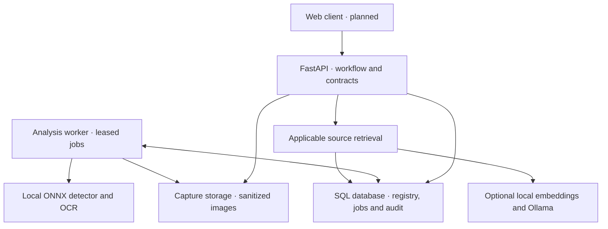

# posify

Web-first infrastructure for identifying industrial equipment, retrieving applicable
maintenance knowledge and recording inspections with traceable evidence.

A field user uploads an equipment or nameplate image. Local inference produces
regions, text and identifier evidence; the backend proposes factory asset matches
for human confirmation. Confirmed assets connect shared manufacturer/model knowledge
to factory-specific procedures and inspection records.

**Status:** backend development. The API, persistence, capture workflow and analysis
worker are implemented. The web client is pending. Detector training runs separately
in Colab; trained weights and field accuracy results are not included here.

## Architecture

The service is a modular Python backend with a separate inference worker. HTTP
contracts separate the future web client from storage, workflow rules and model
adapters. Model outputs enter the system as evidence; explicit API operations own
asset confirmation and inspection state.



| Layer | Technology | Responsibility |
| --- | --- | --- |
| API and contracts | Python 3.12+, FastAPI, Pydantic, OpenAPI | Validation, workflow rules and client integration |
| Persistence | SQLAlchemy, Alembic; SQLite or PostgreSQL | Registry, immutable records, transactions and audit |
| Image evidence | Pillow and filesystem storage | Bounded uploads, normalization and protected access |
| Analysis execution | SQL-backed queue and Python worker | Durable claims, retries and fenced result commits |
| Vision | YOLO11 ONNX Runtime adapter; Tesseract or optional PaddleOCR | Equipment/nameplate regions and identifier text |
| Knowledge assistance | Lexical retrieval; optional local E5 and Ollama | Applicable excerpts and source-labelled answer drafts |
| Runtime | Separate API/worker processes; Docker Compose configuration | Shared database, captures and operator-provisioned models |

Inference runs on the machine hosting the backend/worker. Browser inference is not
implemented. The core API can run without model weights; analysis requires its
selected components to be configured explicitly.

## Data boundaries

**Shared catalogue:** manufacturer, model, variant, category and immutable document
revisions. Models and documents start as drafts and require explicit publication.
A supplied source reference records provenance; it is not manufacturer verification.

**Factory registry:** an organization owns factories; each factory owns installed
assets with local tags, serials, captures and inspection history. A confirmed link
connects an installed asset to a published catalogue model. Shared model knowledge
does not merge the histories of different physical assets.

**Maintenance records:** factory procedures are immutable versions scoped to
manufacturer/model. Each inspection pins a procedure ID. Later revisions do not
rewrite an existing inspection. Retrieval can use applicable factory procedures
and published global documents, with each source kind labelled separately.

These relationships define data ownership. Access currently uses one instance-wide
API key; individual identities and role/site authorization remain to be implemented.

## Capture-to-inspection workflow

1. Register the organization, factory, installed assets and applicable procedures.
2. Upload raw PNG/JPEG bytes. The API validates dimensions, applies orientation,
   removes metadata and stores a normalized capture.
3. Enqueue `ocr` or `detect_ocr`. The worker reads the capture, runs configured
   inference and persists text, regions, warnings and candidate matches.
4. Review the evidence and explicitly confirm the physical asset. Visual category
   alone cannot establish identity; ambiguous identifier evidence causes abstention.
5. Retrieve applicable source material, create an inspection, attach confirmed
   captures and record a result for each procedure step.
6. Submit the inspection. Failed and unknown findings remain explicit; submission
   records completion of data entry and does not represent supervisor approval.

## Correctness guarantees

- Asset location/category updates require an expected revision and a reason. Stale
  edits return `409`; successful changes increment the revision and audit before/after values.
- Observation UUIDs make exact retries safe; changed content under the same ID
  returns `409`. Capture confirmation and evidence attachment also support safe retries.
- Observations and their audit events commit together. Submitted inspections reject
  further changes; attaching evidence never completes a procedure step.
- Workers claim jobs atomically and run inference outside transactions. Only the
  current, unexpired claim can commit its analysis and successful job state together.
- OCR identifier matching requires explicit printed labels. Supplied tag and serial
  evidence must agree with the same asset; no category-only fallback is used.
- The assistant has no mutation tools. Generated answers are unverified drafts with
  checked source IDs; citation presence does not establish factual correctness.
- Site-pack version 2 is a consistent full JSON snapshot. It is not incremental
  synchronization and does not embed image bytes, OCR analyses or global documents.

## Run locally

Use Python 3.12 or newer. The following commands use a POSIX shell:

```bash
python -m venv .venv
source .venv/bin/activate
pip install -r requirements-dev.lock
pip install --no-deps -e .
export POSIFY_API_TOKEN="$(python -c 'import secrets; print(secrets.token_urlsafe(32))')"
uvicorn posify.app:app --host 127.0.0.1 --port 8000
```

SQLite is created and migrated at `var/posify.db` by default. Business endpoints
require `X-API-Key`; `/health` is public. Open [interactive API docs](http://127.0.0.1:8000/docs)
and use **Authorize** with the generated token. Environment settings are documented
in [.env.example](.env.example); shell-based execution requires exporting them.

In another terminal, activate the environment and supply the same token:

```bash
python scripts/demo.py
# Start separately when using queued capture analysis:
python -m posify.worker
```

For a real OCR smoke walkthrough, install Tesseract with English language data,
set `POSIFY_OCR_ENGINE=tesseract` for the API/worker, then run
`python scripts/capture_demo.py`. This uses synthetic nameplates, not field evaluation.

### PostgreSQL and containers

For a direct PostgreSQL setup, export `POSIFY_DATABASE_URL` using a
`postgresql+psycopg://...` URL and run `python scripts/migrate.py` before starting
the API or worker. PostgreSQL does not auto-migrate by default.

For Compose, copy `.env.example` to `.env`, replace the token placeholder and set a
generated URL-safe `POSIFY_DB_PASSWORD`, then run:

```bash
mkdir -p models
docker compose up --build
```

Compose defines PostgreSQL 17, a one-shot migration service, the API and a separate
worker. The API binds to loopback port 8000; captures and database use persistent
volumes. The image includes Tesseract; optional ML runtimes and weights need separate
provisioning. This Compose configuration has not been executed on the development
host. See [database and deployment](docs/DATABASE.md) for operational details.

## Model integration

| Component | Configuration | Current verification |
| --- | --- | --- |
| OCR baseline | `POSIFY_OCR_ENGINE=tesseract` | Real synthetic-nameplate walkthrough and parsing tests |
| PaddleOCR | `.[ocr]`, local detection/recognition directories | Adapter tests; no real-weight evaluation |
| YOLO11 detector | `.[detector]`, `POSIFY_DETECTOR_MANIFEST` | Manifest, preprocessing, decoding and crop-coordinate tests; trained export pending |
| E5 retrieval | `.[retrieval]`, `POSIFY_EMBEDDING_DIR` | Controlled encoder tests; local weights not evaluated |
| Ollama drafts | `POSIFY_OLLAMA_MODEL`, optional runtime URL | Simulated responses; model evaluation pending |

Weights are provisioned by the operator; the application does not download them.
`GET /v1/runtime` reports configuration, not successful inference or model quality.
Missing configured components fail explicitly. Training scripts remain outside this
repository. The [detector contract](docs/DETECTOR_CONTRACT.md) defines the exact
static FP32 ONNX export required from Colab, including class order and SHA-256.
See [local model configuration](docs/LOCAL_MODELS.md) for setup and limitations.

## Repository map

| Path | Contents |
| --- | --- |
| [services/api/posify/](services/api/posify/) | API, domain rules, persistence, inference adapters and worker |
| [services/api/posify/migrations/](services/api/posify/migrations/) | Versioned Alembic schema changes |
| [services/api/tests/](services/api/tests/) | Workflow, scope, replay, migration and adapter verification |
| [packages/contracts/openapi.json](packages/contracts/openapi.json) | Generated client-facing API contract |
| [scripts/](scripts/) | Migrations, smoke walkthroughs and contract export |
| [compose.yaml](compose.yaml) | Database, migrations, API and worker runtime configuration |
| [docs/CAPTURE_API.md](docs/CAPTURE_API.md) | Upload, confirmation and inspection evidence reference |
| [docs/ANALYSIS_JOBS.md](docs/ANALYSIS_JOBS.md) | Queue API, worker operation and failure semantics |
| [docs/DATABASE.md](docs/DATABASE.md) | Ownership, migration and deployment reference |

## Validation and remaining work

```bash
pytest -q
python scripts/export_contracts.py --check
```

CI exercises the backend against SQLite and PostgreSQL. The local SQLite suite
currently covers 63 tests; PostgreSQL validation runs in CI. This does not establish industrial detection
accuracy, latency or production readiness. Optional model extras are outside the
core dependency lock and require their own environment validation.

Remaining engineering work includes the web client, individual authentication and
site/role authorization, reviewed identity/link corrections, supervisor review,
PDF ingestion, persistent retrieval indexing, model evaluation and operating controls
for quotas, monitoring, retention and tested backup restoration. Queue heartbeats
and cancellation are also pending. QR decoding, 3D reconstruction and work-order
integrations are outside the current implementation.
